  <picture>
    <source media="(prefers-color-scheme: dark)" srcset="./dark.svg">
    <source media="(prefers-color-scheme: light)" srcset="./light.svg">
    
  </picture>

 

## 👨‍💻 About Me

I am a **Firmware Validation Engineer & GenAI Developer** with over 8 years of experience bridging the gap between embedded hardware and artificial intelligence. My background spans post-silicon validation, Embedded Controller (EC) interfaces, and building autonomous AI agents to automate complex engineering workflows.

- 🚀 **Currently Building:** Local RAG workflows and autonomous test generation agents.
- ⚡ **Specialized In:** Embedded controllers (eSPI, I2C, I3C, SPI, UART) and hardware protocol analyzers.
- 🏓 **Fun Fact:** I train 10 hours a week as a state-ranking competitive table tennis player!

## 🛠️ Engineering Stack

- **Languages:** Python, C, C++
- **AI / Data:** GenAI workflows, Local LLMs (Ollama), FastAPI, MySQL, ChromaDB
- **Hardware / Validation:** EC Platforms, Logic Analyzers (Acute TLW/MSO), Oscilloscopes, Beagle
- **Tools:** Git, GitHub Copilot, VS Code

## 📈 GitHub Stats

  
  

## 🤝 Connect With Me

  
  
  

